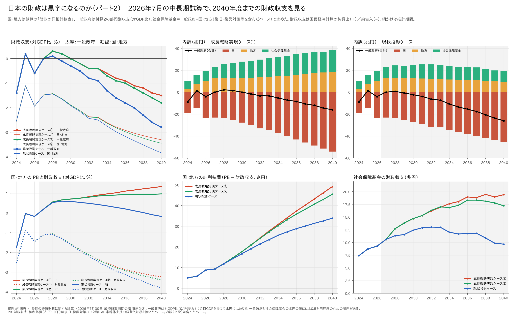

# 日本の財政は黒字になるのか（パート2）──2026年7月の中長期試算で、2040年度までの国・地方・社会保障基金の財政収支を見る

※ この記事は「[日本の財政は黒字になるのか──内閣府の経済財政モデルで、国・地方・社会保障基金の財政収支を計算した](04_財政は黒字になるのかを経済財政モデルで計算した.md)」（以下、パート1）の続きである。

パート1では、内閣府の中長期試算（2026年1月）を経済財政モデル（2026年度版）の Python 再現で計算し直し、国民経済計算（SNA）の財政収支を国・地方・社会保障基金に分けて取り出した。結論は「一般政府（国・地方＋社会保障基金）の財政収支は2027年度に黒字になる。ただし黒字を生むのは社会保障基金で、国・地方は赤字のまま」だった。

その後、内閣府は2026年7月30日に中長期試算を改訂した。今回の試算は、

- 計算期間が **2040年度まで** 延びた（「骨太方針2026」の中長期経済財政計画の期間が2027〜2040年度のため）
- ケースが **成長戦略実現ケース①・②、現状投影ケース** の3つに変わった
- 2027年度以降、国が **毎年度、実質10兆円の追加財政支出** を行う前提が入った（『「強く豊かな日本」投資枠』等を念頭に置いたもの。その後は物価・賃金上昇率並みに増える）

という点で、1月の試算とかなり姿が違う。そこでパート2では、7月の試算で2040年度まで、国・地方・社会保障基金・一般政府の財政収支を並べてみた。

結果を先に書くと、次のようになった。

- **一般政府の財政収支は、黒字になってもごくわずかで、2030年代には赤字が広がる。** 成長戦略実現ケース①・②でも黒字は2028・2029年度の対GDP比+0.2〜0.3%（1.5〜2.2兆円）だけで、2031年度に赤字へ戻る。2040年度には▲1.5%（ケース①）〜▲2.8%（現状投影）になる。1月の試算をもとにしたパート1の計算（成長移行ケースで2027〜2031年度に+0.4〜0.7%）より、はっきり悪い。
- **社会保障基金の黒字は、1月の試算をもとにした計算より大きい。** 2024年度の7.4兆円から、成長戦略実現ケース①では2030年代に18〜19兆円（対GDP比1.8〜2.0%）まで増える。現状投影ケースでも2030年代前半は12〜13兆円ある。
- **それでも一般政府が赤字になるのは、国の赤字が膨らむからである。** 国の財政収支は2040年度に▲45〜54兆円（対GDP比▲5%前後）になる。国・地方のPBが黒字でも、純利払費が2040年度に34〜49兆円（対GDP比3.6〜4.6%）まで増えるからだ。

## 計算の結果

### 2024〜2040年度の財政収支（兆円）

カッコ内は対GDP比（％）。国・地方は試算の「財政の詳細計数表」の値、一般政府は付録2の部門別収支（対GDP比）に名目GDPを掛けた値、社会保障基金はその差である（求め方は下の「計算の方法」）。

**成長戦略実現ケース①**

| 年度 | 国 | 地方 | 社会保障基金 | 一般政府 |
|---|---:|---:|---:|---:|
| 2024（実績） | ▲19.3（▲3.0） | +2.9（+0.4） | +7.4（+1.2） | ▲9.0（▲1.4） |
| 2025 | ▲14.6（▲2.2） | +7.2（+1.1） | +8.7（+1.3） | +1.3（+0.2） |
| 2026 | ▲23.7（▲3.4） | +10.3（+1.5） | +9.3（+1.3） | ▲4.1（▲0.6） |
| 2027 | ▲23.2（▲3.2） | +12.6（+1.8） | +10.6（+1.5） | 0.0（0.0） |
| 2028 | ▲23.5（▲3.2） | +13.0（+1.8） | +12.7（+1.7） | +2.2（+0.3） |
| 2029 | ▲25.2（▲3.3） | +12.9（+1.7） | +13.8（+1.8） | +1.5（+0.2） |
| 2030 | ▲27.8（▲3.6） | +13.1（+1.7） | +14.7（+1.9） | 0.0（0.0） |
| 2035 | ▲40.3（▲4.4） | +15.0（+1.7） | +18.0（+2.0） | ▲7.3（▲0.8） |
| 2040 | ▲54.2（▲5.0） | +18.7（+1.7） | +19.4（+1.8） | ▲16.1（▲1.5） |

**成長戦略実現ケース②**（2031年度まではケース①と同じ）

| 年度 | 国 | 地方 | 社会保障基金 | 一般政府 |
|---|---:|---:|---:|---:|
| 2035 | ▲39.8（▲4.4） | +14.3（+1.6） | +17.3（+1.9） | ▲8.1（▲0.9） |
| 2040 | ▲52.4（▲5.0） | +16.4（+1.6） | +17.2（+1.6） | ▲18.8（▲1.8） |

**現状投影ケース**（2027年度まではケース①と同じ）

| 年度 | 国 | 地方 | 社会保障基金 | 一般政府 |
|---|---:|---:|---:|---:|
| 2028 | ▲23.5（▲3.2） | +13.0（+1.8） | +11.3（+1.5） | +0.7（+0.1） |
| 2029 | ▲25.1（▲3.4） | +12.7（+1.7） | +11.6（+1.5） | ▲0.7（▲0.1） |
| 2030 | ▲27.3（▲3.6） | +12.6（+1.6） | +12.4（+1.6） | ▲2.3（▲0.3） |
| 2035 | ▲36.5（▲4.3） | +11.3（+1.3） | +11.7（+1.4） | ▲13.5（▲1.6） |
| 2040 | ▲45.3（▲4.9） | +9.6（+1.0） | +9.7（+1.0） | ▲26.0（▲2.8） |

全年度の値は [chuuchouki2607_balance.csv](chuuchouki2607_balance.csv) にある。

### 一般政府：黒字は2028・2029年度だけ、それもごくわずか

一般政府の財政収支（対GDP比）は、2025年度に+0.2%といったん黒字になる（2025年度は決算概要にもとづく実績見込み）。2026年度は補正予算で▲0.6%に戻り、2027年度に0.0%、2028年度に+0.3%（現状投影ケースは+0.1%）が最大で、その後は下がり続ける。

- **成長戦略実現ケース①・②**：2028・2029年度に+0.3%・+0.2%の黒字、2030年度に0.0%、2031年度から赤字。2040年度は▲1.5%（①）、▲1.8%（②）。
- **現状投影ケース**：黒字は2028年度の+0.1%だけで、2029年度から赤字。2040年度は▲2.8%（▲26兆円）。

パート1（1月の試算の成長移行ケースをモデルで再現した計算）では、一般政府は2027〜2031年度に+0.4〜0.7%の黒字が続いた。7月の試算では、黒字の幅も期間もずっと小さい。

### 国：追加財政支出と利払費で赤字が広がる

赤字のほとんどは国である。国の財政収支は2027・2028年度の▲3.2%から、2040年度には▲5.0%（ケース①・②）まで広がる。

理由は2つある。

1. **追加財政支出**：2027年度から毎年度、実質10兆円の追加財政支出が入る（半分は公需、半分は企業の資本コストを下げる補助金という想定）。1月の試算にはなかった歳出で、2027年度の名目GDPの1.4%にあたる大きさである。国・地方の PB 黒字は2027年度+0.2%、2030年度+0.7%と、1月の試算（成長移行ケースで2030年度+1.4%）の半分程度にとどまる。
2. **金利と利払費**：名目長期金利の前提が上がった（2026年度2.7%、成長戦略実現ケース①で2040年度3.8%。1月の試算では2026年度2.1%）。国・地方の純利払費は2024年度の5.1兆円（対GDP比0.8%）から、2030年度に17〜18兆円、2040年度に34〜49兆円（3.6〜4.6%）まで増える。

その結果、国・地方の PB は成長戦略実現ケース①で2040年度に+1.3%の黒字まで改善するのに、財政収支は▲3.2%で、赤字は広がり続ける。現状投影ケースでは PB そのものが2039年度に赤字へ戻り、財政収支は▲3.8%になる。

### 地方：黒字だが、現状投影ケースでは縮む

地方は PB も財政収支も黒字である。財政収支は2027年度以降+12〜13兆円（1.6〜1.8%）で、成長戦略実現ケース①では2040年度に+18.7兆円まで増える。一方、現状投影ケースでは2040年度に+9.6兆円（1.0%）まで縮む。地方は公債等残高が国より小さいので、金利が上がっても利払費の増え方が小さい。

### 社会保障基金：黒字は1月の試算をもとにした計算より大きい

社会保障基金の黒字は、主に公的年金の積立金の利子・配当（SNA の財産所得）である。7月の試算は「2024年度の社会保障基金の黒字7.5兆円のうち7.0兆円は財産所得（純）」と注記している。

- **成長戦略実現ケース①・②**：2024年度の7.4兆円（1.2%）から増え、2033〜2036年度に対GDP比2.0%前後（17〜19兆円）で頭打ちになり、その後は高齢化による給付増で少しずつ縮む（2040年度1.6〜1.8%）。
- **現状投影ケース**：2030年代前半の12〜13兆円（1.6%前後）が最大で、2040年度は9.7兆円（1.0%）。

パート1の計算（1月の試算の成長移行ケース）では、社会保障基金の黒字は2030年度に10.8兆円、2035年度に12.6兆円だった。7月の試算から割り出した値はそれより4〜5兆円程度大きい。7月の試算は「運用利回りが経済成長とともに上がる」「女性・高齢者の労働参加が進んで保険料収入がすぐに増える一方、給付の増加は将来になる」ことを理由に挙げている。金利の前提が上がったことも、積立金の利子収入を通じて黒字を押し上げていると考えられる。

ただし、社会保障基金の黒字が大きくなっても、国の赤字の拡大には追いつかない。2040年度には、社会保障基金の黒字（10〜19兆円）は国の赤字（45〜54兆円）の2〜4割しか埋められない。

### パート1（2026年1月の試算）との比較

| | 1月の試算（パート1） | 7月の試算（パート2） |
|---|---|---|
| ケース | 過去投影、成長移行（高成長実現） | 現状投影、成長戦略実現①・② |
| 計算期間 | 2035年度まで | 2040年度まで |
| 追加財政支出 | なし | 2027年度以降、毎年度実質10兆円 |
| 国・地方の財政収支（2030年度） | ▲4.3兆円（成長移行、内閣府試算） | ▲12.2兆円（成長戦略実現①、内閣府試算） |
| 社会保障基金（2030年度） | +10.8兆円（成長移行、モデル） | +14.7兆円（成長戦略実現①、試算から割り出し） |
| 一般政府の黒字の期間 | 2027〜2035年度（成長移行、モデル） | 2028・2029年度だけ（成長戦略実現①・②） |
| 一般政府（2035年度） | +0.2%（成長移行、モデル） | ▲0.8%（成長戦略実現①） |

パート1の社会保障基金と一般政府はモデルの値、パート2は内閣府の試算から割り出した値なので、厳密に同じ物差しではない（パート1では、モデルの国・地方の赤字は内閣府試算より毎年1〜3兆円大きかった）。それでも、追加財政支出と金利上昇で、一般政府の姿が「小幅の黒字が続く」から「黒字はほぼ一瞬で、2030年代は赤字拡大」に変わったことははっきりしている。

## 計算の方法

- **国・地方**：試算の「2.財政の詳細計数表」の【国・地方の財政の姿】の財政収支（国、地方の内訳）を使った。一般政府と足し合わせる内訳（表と図の上段）には「復旧・復興対策、GX対策及びAI・半導体支援の経費及び財源の金額を含んだベース」（参考表）、PB と純利払費（図の下段左・中）には、主要計数表と同じ「除いたベース」を使った。
- **一般政府**：試算の「付録2 部門別収支と国民総所得の推移」の一般政府の部門別収支（対GDP比）に、主要計数表の名目GDPを掛けて兆円にした。
- **社会保障基金**：一般政府−国・地方（含んだベース）。2024年度は7.4兆円で、試算の注にある実績（7.5兆円）とほぼ一致する。対GDP比は、試算の図19（一般政府の部門別収支対GDP比）の社会保障基金の値（2028年度1.6〜1.7%、2040年度1.0〜1.7%）とも丸めの範囲で合う。
- **純利払費**：国・地方の PB − 財政収支（除いたベース）。
- **丸めの誤差**：一般政府の対GDP比は0.1%刻みなので、一般政府と社会保障基金の兆円の値には±0.5兆円程度の誤差がある。

数値の取り出しと図のコードは [extract_2607.py](extract_2607.py)、[chart_part2.py](chart_part2.py) にある。

## 注意

- パート2は、**経済財政モデルの再現で計算し直したものではなく、内閣府の7月の試算の公表値から割り出したもの** である。7月の試算（3ケース、2040年度まで、追加財政支出あり）を再現モデルで作り直すのは今後の課題である。
- 追加財政支出の中身（官民投資の計画、危機管理投資・成長投資の内容など）はまだ決まっておらず、試算は「機械的に実質10兆円」と置いている。中身や規模が変われば、国の財政収支も変わる。
- 社会保障基金の黒字は将来の年金給付のための積立金の運用益であり、一般政府の収支が改善しても、国・地方の借金（公債等残高）が減るわけではない。公債等残高の対GDP比は、成長戦略実現ケース①では2040年度に170.6%まで下がるが、現状投影ケースでは2030年代に上昇に転じ、2040年度に190.6%になる。

## 出典

- 内閣府「中長期の経済財政に関する試算」（2026年7月30日、経済財政諮問会議 資料2-2）：[https://www5.cao.go.jp/keizai-shimon/kaigi/minutes/2026/0730shiryo_02-2.pdf](https://www5.cao.go.jp/keizai-shimon/kaigi/minutes/2026/0730shiryo_02-2.pdf)
- 内閣府「中長期の経済財政に関する試算」（2026年1月）：[https://www5.cao.go.jp/keizai3/econome/r8chuuchouki2601.pdf](https://www5.cao.go.jp/keizai3/econome/r8chuuchouki2601.pdf)
- 内閣府「経済財政モデル（2026年度版）資料集」：[https://www5.cao.go.jp/keizai3/econome.html](https://www5.cao.go.jp/keizai3/econome.html)
- パート1：[04_財政は黒字になるのかを経済財政モデルで計算した](https://github.com/p72/note-draft/blob/main/%E5%86%85%E9%96%A3%E5%BA%9C%E3%81%AE2%E3%81%A4%E3%81%AE%E3%83%9E%E3%82%AF%E3%83%AD%E3%83%A2%E3%83%87%E3%83%AB/04_%E8%B2%A1%E6%94%BF%E3%81%AF%E9%BB%92%E5%AD%97%E3%81%AB%E3%81%AA%E3%82%8B%E3%81%AE%E3%81%8B%E3%82%92%E7%B5%8C%E6%B8%88%E8%B2%A1%E6%94%BF%E3%83%A2%E3%83%87%E3%83%AB%E3%81%A7%E8%A8%88%E7%AE%97%E3%81%97%E3%81%9F.md)
