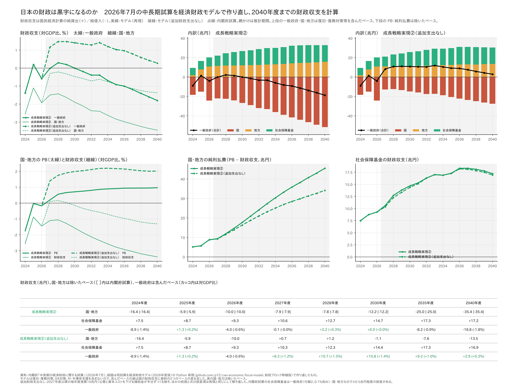
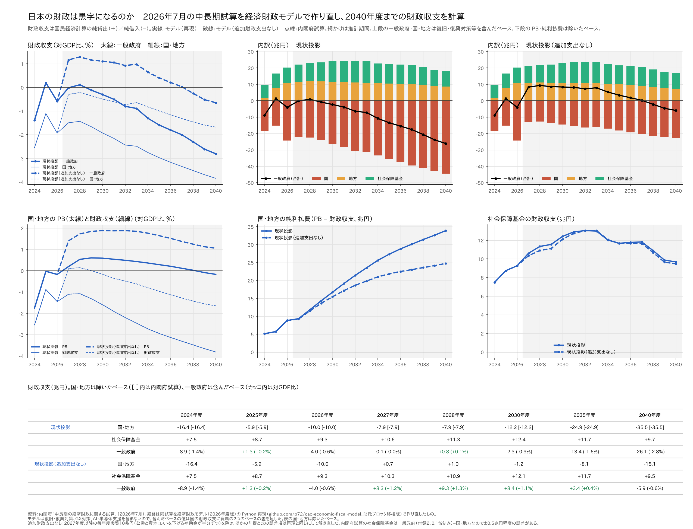

# 2026/7版での中長期見通し

※ この記事は「日本の財政は黒字になるのか」のパート3である。
- パート1：[日本の財政は黒字になるのか──内閣府の経済財政モデルで、国・地方・社会保障基金の財政収支を計算した](https://github.com/p72/note-draft/blob/main/%E5%86%85%E9%96%A3%E5%BA%9C%E3%81%AE2%E3%81%A4%E3%81%AE%E3%83%9E%E3%82%AF%E3%83%AD%E3%83%A2%E3%83%87%E3%83%AB/04_%E8%B2%A1%E6%94%BF%E3%81%AF%E9%BB%92%E5%AD%97%E3%81%AB%E3%81%AA%E3%82%8B%E3%81%AE%E3%81%8B%E3%82%92%E7%B5%8C%E6%B8%88%E8%B2%A1%E6%94%BF%E3%83%A2%E3%83%87%E3%83%AB%E3%81%A7%E8%A8%88%E7%AE%97%E3%81%97%E3%81%9F.md)（2026年1月の中長期試算をモデルで計算、2035年度まで）
- パート2：[2026年7月の中長期試算で、2040年度までの国・地方・社会保障基金の財政収支を見る](../article_part2/04-2_財政は黒字になるのか_パート2_2040年度まで.md)（7月の試算の公表値から割り出したもの。モデルは使っていない）

パート2では、内閣府の中長期試算（2026年7月）の公表値から、国・地方・社会保障基金、そしてそれらを合わせた一般政府の財政収支を2040年度まで並べた。分かったのは、7月の試算では一般政府の黒字が2028・2029年度にほんの少し出るだけで、2030年代には赤字が広がる、ということだった。1月の試算から大きく変わった理由の一つが、2027年度以降、国が**毎年度、実質10兆円の追加財政支出**を行うという前提である。

ただ、公表値を眺めるだけでは「その10兆円がなかったら財政はどうなっていたか」は分からない。そこでパート3では、内閣府の経済財政モデル（2026年度版）の Python 再現で7月の試算を2040年度まで作り直し、そのうえで**追加財政支出をやめた場合**を計算した。対象は成長戦略実現ケース①・②と現状投影ケースの3つである。

結果を先に書くと、次のようになった。

- **モデルは7月の試算をほぼそのまま再現できた。** 2040年度の名目GDP・PB・公債等残高比は、成長戦略実現ケース①で1073.6兆円・1.34%・172.1%（資料1073.6兆円・1.3%・170.6%）、②で1043.4兆円・0.97%・176.0%（資料1043.5兆円・1.0%・174.6%）、現状投影ケースで929.8兆円・−0.17%・192.0%（資料929.6兆円・−0.2%・190.6%）。
- **追加財政支出がなければ、一般政府は2027年度から対GDP比1%を超える黒字になる。** 成長戦略実現ケース①・②では2040年度まで黒字が続き（2040年度に①+0.6%、②+0.3%）、現状投影ケースでも2037年度まで黒字が続く。追加財政支出がある場合（試算の姿）は、黒字は2028・2029年度のわずかな幅だけである。
- **国・地方の財政収支も、2027〜2029年度はほぼ均衡する。** 2040年度の改善幅は20〜22兆円で、追加財政支出の額（13〜14兆円）より大きい。国債の発行が減って利払費が9〜12兆円少なくなり、モデルでは長期金利も0.3〜0.5%pt下がるからである。
- **その代わり、経済は小さくなる。** 実質GDPは2027年度に0.85%低く、2040年度にも0.3%低い。名目GDPは2040年度に15〜18兆円（1.6〜1.7%）小さい。それでも公債等残高比は2040年度に20%pt前後低くなる（ケース①172%→152%、②176%→156%、現状投影192%→171%）。

## 計算の結果

### 成長戦略実現ケース①

### 成長戦略実現ケース②

ケース②はケース①と2031年度まで同じで、TFP 上昇率が1.1%で止まる（①は1.4%まで上がる）ぶん、2032年度以降の成長と金利が低い。

### 現状投影ケース

図の見方：実線がモデルで再現した7月の試算の姿、破線が追加財政支出をやめた場合、点線が内閣府の試算（公表値）である。上段の一般政府・国・地方は、国民経済計算（SNA）の財政収支（純貸出（＋）／純借入（−））で、復旧・復興対策、GX対策、AI・半導体支援の経費と財源を含んだベース（一般政府の公表値と同じベース）、下段の PB・純利払費はそれらを除いたベース（主要計数表と同じベース）である。

### 一般政府の財政収支（兆円、カッコ内は対GDP比）

| 年度 | ①試算の姿 | ①追加支出なし | ②試算の姿 | ②追加支出なし | 現状投影 試算の姿 | 現状投影 追加支出なし |
|---|---:|---:|---:|---:|---:|---:|
| 2024（実績） | ▲8.9（▲1.4%） | 同左 | 同左 | 同左 | 同左 | 同左 |
| 2025 | +1.3（+0.2%） | 同左 | 同左 | 同左 | 同左 | 同左 |
| 2026 | ▲4.0（▲0.6%） | 同左 | 同左 | 同左 | 同左 | 同左 |
| 2027 | ▲0.1（0.0%） | **+8.3（+1.2%）** | ▲0.1（0.0%） | **+8.3（+1.2%）** | ▲0.1（0.0%） | **+8.3（+1.2%）** |
| 2028 | +2.2（+0.3%） | +10.7（+1.5%） | +2.2（+0.3%） | +10.7（+1.5%） | +0.8（+0.1%） | +9.3（+1.3%） |
| 2030 | 0.0（0.0%） | +10.8（+1.4%） | 0.0（0.0%） | +10.8（+1.4%） | ▲2.3（▲0.3%） | +8.4（+1.1%） |
| 2035 | ▲7.3（▲0.8%） | +10.3（+1.1%） | ▲8.2（▲0.9%） | +9.2（+1.0%） | ▲13.4（▲1.6%） | +3.4（+0.4%） |
| 2040 | ▲16.1（▲1.5%） | +6.0（+0.6%） | ▲18.8（▲1.8%） | +2.9（+0.3%） | ▲26.1（▲2.8%） | ▲5.9（▲0.6%） |

2026年度までは追加財政支出がないので、6つの姿は同じである。ケース①と②は2031年度まで同じ。

### 国・地方の財政収支（兆円、除いたベース）

| 年度 | ①試算の姿 | ①追加支出なし | ②試算の姿 | ②追加支出なし | 現状投影 試算の姿 | 現状投影 追加支出なし |
|---|---:|---:|---:|---:|---:|---:|
| 2027 | ▲7.9 | +0.7 | ▲7.9 | +0.7 | ▲7.9 | +0.7 |
| 2028 | ▲7.8 | +1.2 | ▲7.8 | +1.2 | ▲7.9 | +1.0 |
| 2030 | ▲12.2 | ▲1.1 | ▲12.2 | ▲1.1 | ▲12.2 | ▲1.2 |
| 2035 | ▲24.8 | ▲7.2 | ▲25.0 | ▲7.6 | ▲24.9 | ▲8.1 |
| 2040 | ▲34.8 | ▲12.3 | ▲35.4 | ▲13.5 | ▲35.5 | ▲15.1 |

### そのほかの指標（2040年度）

| | ①試算の姿 | ①追加支出なし | ②試算の姿 | ②追加支出なし | 現状投影 試算の姿 | 現状投影 追加支出なし |
|---|---:|---:|---:|---:|---:|---:|
| 名目GDP（兆円） | 1073.6 | 1055.3 | 1043.4 | 1025.8 | 929.8 | 914.7 |
| 名目長期金利（%） | 3.80 | 3.43 | 3.40 | 3.04 | 2.40 | 2.06 |
| 国・地方の PB（対GDP比） | +1.34% | +2.35% | +0.97% | +2.02% | ▲0.17% | +1.06% |
| 国・地方の純利払費（兆円） | 49.2 | 37.1 | 45.5 | 34.2 | 33.9 | 24.8 |
| 社会保障基金の財政収支（兆円） | +19.4 | +19.1 | +17.2 | +16.9 | +9.7 | +9.5 |
| 公債等残高（対GDP比） | 172.1% | 152.3% | 176.0% | 156.0% | 192.0% | 170.7% |

全年度の値は [chuuchouki2607_model_balance.csv](chuuchouki2607_model_balance.csv) にある（scen 列が base＝試算の姿、noextra＝追加支出なし。国・一般政府は含んだベース、国・地方は除いたベース）。

## 読みどころ

### 1. 一般政府の黒字が「一瞬」で終わるのは、追加財政支出のため

パート2で見たとおり、7月の試算の一般政府は2028・2029年度に対GDP比+0.1〜0.3%の黒字になるだけで、成長戦略実現ケース①・②でも2031年度、現状投影ケースでは2029年度に赤字に戻る。

追加財政支出をやめると、一般政府は2027年度に+1.2%の黒字になり、成長戦略実現ケース①・②では2040年度まで黒字が続く（②は2040年度に+0.3%と、①より黒字が小さい）。現状投影ケースでも2037年度までは黒字で、赤字に戻るのは2038年度である。2027年度の追加財政支出は名目GDPの1.4%にあたるので、それがなくなれば一般政府の収支は1%程度改善する。PB の黒字を「一瞬」で終わらせているのは、追加財政支出の大きさそのものである。

### 2. 財政収支の改善は、追加財政支出の額より大きい

2040年度の追加財政支出は名目で13〜14兆円（2027年度の10兆円を物価・賃金上昇率並みに伸ばした額）だが、国・地方の財政収支は20〜22兆円改善する。差の大部分は利払費である。

- **国債の発行が減る**：追加財政支出は全額が国債で賄われる。2027年度から毎年10兆円を超える発行がなくなると、利払費の減少も含めて、2040年度の公債等残高は220〜240兆円少なくなる。
- **金利が下がる**：モデルの長期金利の式は「短期金利（コールレート）の0.97倍＋前年度の公債等残高比の上昇率×11.1」という形で、追加財政支出がなくなると、景気と物価がやや弱くなって短期金利が下がり、残高比の上昇も止まる。長期金利は2030〜2035年度に0.4〜0.5%pt、2040年度に0.3〜0.4%pt低くなる。

その結果、国・地方の純利払費は2040年度に成長戦略実現ケース①で49兆円→37兆円、②で46兆円→34兆円、現状投影ケースで34兆円→25兆円になる。PB の改善（10〜11兆円）に、利払費の減少（9〜12兆円）が上乗せされる。

### 3. 経済は小さくなる。ただし財政の改善のほうが大きい

追加財政支出の半分は公需（政府消費・公共投資）なので、それをやめると需要が減る。実質GDPは2027年度に0.85%低くなり、2027年度の実質成長率は1.1%から0.2%に落ちる。その後は差が縮むが、補助金がなくなって企業の資本コストが上がり、設備投資と資本ストックが少し伸び悩むため、2040年度にも0.3%低い。名目GDPでは15〜18兆円（1.6〜1.7%）小さい。

それでも、分母の名目GDPの減少（約1.7%）より、分子の公債等残高の減少（約13%）のほうがずっと大きいので、公債等残高比は2040年度に20%pt前後低くなる。追加財政支出がないと、現状投影ケースでも公債等残高比は緩やかに下がり（2027年度183.5%→2040年度170.7%）、上がり続ける姿にはならない。

### 4. 社会保障基金はほとんど変わらない

社会保障基金の黒字（年金積立金の利子・配当がほとんど）は、追加財政支出があってもなくてもほぼ同じである（2040年度にケース①で19兆円台、②で17兆円前後、現状投影で10兆円弱）。一般政府の収支の違いは、ほぼすべて国の収支の違いから来ている。

## 計算の方法

- **モデル**：内閣府「経済財政モデル（2026年度版）」の Python 再現（[p72/cao-economic-fiscal-model](https://github.com/p72/cao-economic-fiscal-model)、財政ブロック移植版）。7月の試算に合わせて、国債の発行年度の積み上げを2040年度まで延ばした。
- **試算の姿（再現）**：マクロの7項目（潜在成長率、実質GDP成長率、消費者物価、GDPデフレーター、失業率、賃金、名目長期金利）と、財政の詳細計数表の予算ベースの項目（国のPB対象経費、地方の一般歳出、国の利払費・税収・その他収入、地方の税収、地方交付税等）を全期間資料に合わせた。さらに、国・地方の PB と純利払費（SNA）、社会保障基金の財政収支（付録2の一般政府から割り出した値）も資料に合わせた。前提（人口、労働参加率、TFP、世界経済、原油）は試算の付録1による。
- **追加財政支出なし**：再現の式の誤差項と外生変数をそのまま使い、2027年度以降の追加財政支出（2027年度10兆円、以降は物価・賃金上昇率並み、名目）だけを除いて解き直した。試算の「公需と、企業の資本コストを下げる補助金が半分ずつ」に合わせて、半分は国の政府消費と公共投資（実質）を減らし、残りの半分は国から企業への資本移転を減らして、そのぶん資本コストを上げた。国の予算の歳出（PB対象経費）は追加財政支出の額だけ減る。金利・税収・地方交付税・社会保障などはモデルの式で動く。
- **ベース**：モデルは復旧・復興対策、GX対策、AI・半導体支援の経費と財源を含まない（除いたベース）。一般政府と国の財政収支は、公表されている一般政府（付録2）と比べられるように、資料の2つのベースの差（2027年度で約3兆円、2035年度以降は0.5〜0.7兆円）を国の財政収支に足して、含んだベースで示した。追加財政支出なしの場合も同じ額を足している。

## 注意

- **成長戦略の効果は残したまま**である。成長戦略実現ケース①・②の TFP 上昇率や労働参加率の前提は、追加財政支出なしでも変えていない。試算は成長戦略の効果を「追加財政支出による需要増加のほか、官民投資ロードマップに基づく投資の効果等」としているので、追加財政支出をやめれば成長戦略の効果も小さくなるかもしれない。その分、ケース①・②の「追加支出なし」は楽観的である。現状投影ケースは「追加財政支出による需要増加の効果のみ発現する場合」なので、こちらの「追加支出なし」のほうが、追加財政支出だけを外した姿として素直に読める。
- **長期金利の低下はモデルの式による**。試算の長期金利はケースごとの前提として置かれていて、追加財政支出の有無で金利がどう変わるかは示されていない。長期金利が試算の姿と同じだとすれば、利払費の減少は小さくなり、2040年度の国・地方の財政収支の改善は20〜22兆円より小さくなる。
- **追加財政支出の中身は決まっていない**。試算も「機械的に」実質10兆円と置いている。中身が投資なのか、補助金なのか、国土強靱化なのかで、経済と財政への効き方は変わる。ここでは試算の想定（公需と補助金が半分ずつ）に合わせた。
- 一般政府の黒字の多くは、社会保障基金（年金積立金の運用益）である。一般政府が黒字でも、国の財政収支は2040年度に追加財政支出なしでも▲23〜29兆円の赤字である。

## 再現の精度

| | 2030年度 | 2035年度 | 2040年度 |
|---|---|---|---|
| ケース① 名目GDP（兆円） | 775.5／776.1 | 907.1／907.2 | 1073.6／1073.6 |
| ケース① PB（対GDP比） | 0.71／0.7 | 1.03／1.0 | 1.34／1.3 |
| ケース① 公債等残高比 | 177.8／177.6 | 173.1／172.4 | 172.1／170.6 |
| ケース② 名目GDP（兆円） | 775.5／776.1 | 899.2／900.4 | 1043.4／1043.5 |
| ケース② PB（対GDP比） | 0.71／0.7 | 0.91／0.9 | 0.97／1.0 |
| ケース② 公債等残高比 | 177.8／177.6 | 174.4／173.5 | 176.0／174.6 |
| 現状投影 名目GDP（兆円） | 763.1／764.4 | 844.3／845.7 | 929.8／929.6 |
| 現状投影 PB（対GDP比） | 0.59／0.6 | 0.28／0.3 | ▲0.17／▲0.2 |
| 現状投影 公債等残高比 | 180.4／180.1 | 183.8／182.9 | 192.0／190.6 |

（モデル／資料）2027〜2040年度の差は、PB で最大0.05%pt、公債等残高比で最大1.5%pt、名目GDP で最大1.4兆円である（名目GDPの差は、2024年度の名目GDPがモデル642.4兆円（2024年度年次推計）、資料642.8兆円であることによる）。

計算のコードは [src/projection2607.py](../../src/projection2607.py)（再現）、[src/noextra2607.py](../../src/noextra2607.py)（追加財政支出なし）、[src/plot_balance2607.py](../../src/plot_balance2607.py)（図）。`python run_all.py --july` で、データの取得から図まで作り直せる（1ケース40分程度）。

## 出典

- 内閣府「中長期の経済財政に関する試算」（2026年7月30日、経済財政諮問会議 資料2-2）：[https://www5.cao.go.jp/keizai-shimon/kaigi/minutes/2026/0730shiryo_02-2.pdf](https://www5.cao.go.jp/keizai-shimon/kaigi/minutes/2026/0730shiryo_02-2.pdf)
- 内閣府「経済財政モデル（2026年度版）資料集」：[https://www5.cao.go.jp/keizai3/econome.html](https://www5.cao.go.jp/keizai3/econome.html)
- 内閣府 経済社会総合研究所「国民経済計算」（2024年度年次推計）：[https://www.esri.cao.go.jp/jp/sna/data/data_list/kakuhou/files/2024/2024_kaku_top.html](https://www.esri.cao.go.jp/jp/sna/data/data_list/kakuhou/files/2024/2024_kaku_top.html)
- 国立社会保障・人口問題研究所「日本の将来推計人口（令和5年推計）」
